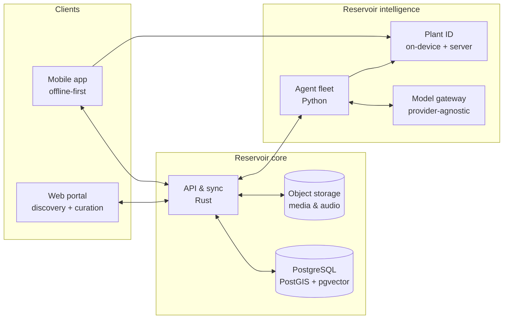

<div align="center">

# 🌿 Reservoir

**A free, open, community-grown memory for South Africa's living culture — plants, practices, languages and the stories that connect them.**

[](ROADMAP.md)
[](LICENSE)
[](docs/legal/licensing.md)
[](CODE_OF_CONDUCT.md)
[](CONTRIBUTING.md)
[](https://github.com/konethegreat/reservoir/actions/workflows/docs.yml)

[Vision](docs/vision/vision.md) · [Roadmap](ROADMAP.md) · [Architecture](docs/architecture/overview.md) · [Research](docs/research/landscape.md) · [Contribute](CONTRIBUTING.md) · [Discussions](https://github.com/konethegreat/reservoir/discussions)

</div>

---

> *Every time an elder passes without being asked, a library burns.*
> Reservoir exists so that fewer of those libraries burn.

## Why Reservoir?

With every year that passes, knowledge of culture and cultural practice fades. A young person walks past a plant their great-grandmother would have named, brewed, eaten or avoided — and does not know what it is, what it does, or what it was called in their own language.

Reservoir is a **free app and open knowledge platform** that connects the modern generation with its past:

1. **Point your camera** at a plant, flower or tree.
2. **Learn** what it is, its names in your language, how it has been used for healing, food, craft and ceremony — with every claim traced to a person, a community or a published source.
3. **Contribute** what *you* know. The platform grows through manual, human input — voices, recipes, songs, practices, words — and an AI that is built *for* this mission helps capture, organise and safeguard it.

We start with **South Africa** and treat its languages as first-class citizens, not translations.

## What it will do

| Pillar | Description |
|---|---|
| 🌱 **Identify** | Photo-based identification of plants, flowers and trees, with an offline-capable on-device model for low-data and low-end phones. |
| 💊 **Traditional uses** | Medicinal, nutritional, ritual and craft uses — each attributed, each with safety notes, never presented as medical advice. |
| 🍲 **Food & dishes** | Recipes and preparation methods linked to the plants, and to the communities that cook them. |
| 🗣️ **Languages** | Names, words, proverbs, songs and audio in South African languages — recorded by the people who speak them. |
| 🪶 **Practices & stories** | Techniques, ceremonies, crafts and oral histories — and how they fit into modern life. |
| 🤝 **Community-owned** | Knowledge holders keep authority over their contributions: consent, visibility, attribution and AI-use are set *by them*. |
| 🤖 **Native AI** | A fleet of purpose-built agents that understand the mission: elicit, transcribe, translate, verify, cross-reference and safeguard — with humans in charge. |

## Languages

South Africa's 12 official languages — including South African Sign Language — plus the Khoi and San languages are in scope. Low-resource languages are a **priority**, not an afterthought. See [`docs/research/languages.md`](docs/research/languages.md).

`English` · `Afrikaans` · `isiZulu` · `isiXhosa` · `isiNdebele` · `Sesotho` · `Sesotho sa Leboa (Sepedi)` · `Setswana` · `siSwati` · `Tshivenda` · `Xitsonga` · `SA Sign Language` · `Khoekhoegowab, N|uu, ǃXun & more`

## Principles (the short version)

1. **Knowledge belongs to its holders.** Consent, attribution and visibility controls are core features, not add-ons.
2. **Free, forever, for people.** No ads, no paywalls on knowledge, no selling data.
3. **Human first, AI assisted.** AI proposes; people with authority decide. AI never invents tradition.
4. **Safety over cleverness.** Plants can heal and plants can kill. Look-alikes and toxicity are surfaced loudly.
5. **Offline by default.** Built for the phones and data costs South Africans actually have.
6. **Protect the plants, too.** Harvest-sensitive species have their locations obscured.

Read the full set in [`docs/vision/principles.md`](docs/vision/principles.md).

## Architecture at a glance



Details: [`docs/architecture/overview.md`](docs/architecture/overview.md)

## Proposed tech stack

A deliberately **polyglot** stack — each language where it is strongest. All of this is *proposed* and recorded as [Architecture Decision Records](docs/adr/) so it can be challenged openly.

| Layer | Choice | Why |
|---|---|---|
| Core API & sync | **Rust** (axum, sqlx) | Fast, memory-safe, tiny footprint — cheap to host in a funding-constrained project. |
| Intelligence / agents | **Python** | The ML ecosystem lives here. Kept behind a clean service boundary. |
| Mobile | **Flutter / Dart** *(pending benchmark spike)* | One codebase, strong offline + on-device ML story, large contributor pool. |
| Web | **TypeScript / Next.js** | SEO for public knowledge pages; curator and admin tools. |
| Data | **PostgreSQL** + PostGIS + pgvector; **SQLite** on device | Relational integrity, geospatial, semantic search; local-first on the phone. |
| Schemas | **JSON Schema / OpenAPI / Protobuf** | One source of truth shared across all languages. |

## Status

🚧 **Planning phase.** This repository currently holds the vision, research, architecture decisions and project governance. No production code exists yet — which makes **now the best time to shape it.** See the [roadmap](ROADMAP.md).

## Get involved

We need far more than programmers.

- 🧓 **Knowledge holders, elders, healers, cooks, craftspeople** — you are the point of this project.
- 🗣️ **Language custodians & translators** — help us do each language properly.
- 🌿 **Botanists, ethnobotanists, pharmacologists** — verification and safety review.
- 🏛️ **Academics, archivists, librarians, legal & IP specialists** — governance and data stewardship.
- 💻 **Developers, ML engineers, designers, writers** — build the thing.

Start with [CONTRIBUTING.md](CONTRIBUTING.md), browse [good first issues](https://github.com/konethegreat/reservoir/labels/good%20first%20issue), or say hello in [Discussions](https://github.com/konethegreat/reservoir/discussions).

## Repository map

```text
reservoir/
├── apps/            # Deployable applications (mobile, web, api)
├── services/        # Backend services (agents)
├── packages/        # Shared libraries and schemas
├── data/            # Taxonomies, seed data, data governance
├── docs/            # Vision, research, architecture, ADRs, product, community
└── .github/         # Templates, workflows, automation
```

## Important disclaimer

Reservoir is an educational and cultural-preservation project. **It does not provide medical advice.** Traditional uses described in the app are cultural knowledge, not prescriptions. Never ingest a plant on the basis of an app's identification alone. See [`docs/architecture/safety-model.md`](docs/architecture/safety-model.md).

## License

- **Code:** [Apache License 2.0](LICENSE)
- **Documentation:** CC BY 4.0
- **Community knowledge:** *not* blanket-licensed — governed per record by its holders. See [`docs/legal/licensing.md`](docs/legal/licensing.md).

## Acknowledgements

Reservoir stands on the shoulders of the [SANBI](https://www.sanbi.org/) National Plant Checklist, [SADiLaR](https://www.sadilar.org/), [Masakhane](https://www.masakhane.io/), [Lelapa AI](https://lelapa.ai/), [Mozilla Common Voice](https://commonvoice.mozilla.org/), [Pl@ntNet](https://plantnet.org/), [iNaturalist](https://www.inaturalist.org/), [GBIF](https://www.gbif.org/), [Local Contexts](https://localcontexts.org/) and the [CARE Principles](https://www.gida-global.org/care) — and above all on the people who held this knowledge long before it had a database.
