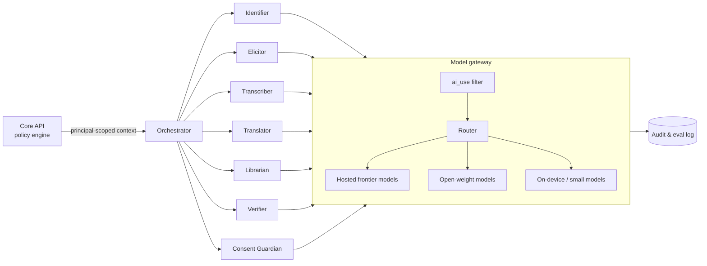

# AI agents — the native intelligence layer

*Status: proposed.*

## What "native" means

The AI is not a chatbot bolted onto a database. It is a set of **specialised agents whose jobs, limits and failure modes are defined by the mission** — preserving cultural knowledge safely, in many languages, under community authority.

Three non-negotiables bind every agent:

1. **Principal-scoped.** An agent acts on behalf of an authenticated principal and sees only what that principal may see, *and* only records whose `ai_use` allows it ([sovereignty](knowledge-sovereignty.md)).
2. **Grounded.** Outputs about culture, use or safety must cite claims. No citation, no assertion.
3. **Supervised.** Agents propose; humans with authority decide. Everything an agent produces is labelled `ai_generated` and starts `unreviewed`.

## The fleet

| Agent | Job | Inputs → Outputs | Autonomy |
|---|---|---|---|
| **Identifier** | Plant identification orchestration | Photos → ranked candidates with calibrated confidence, look-alike flags | Automatic, user-facing |
| **Elicitor** | Interview-style capture in the contributor's language | Speech/text → structured draft claims + clarifying questions | Assists contributor; contributor confirms |
| **Transcriber** | Speech-to-text, per-language models | Audio → transcript + confidence | Automatic; low confidence → human review |
| **Translator** | Draft cross-language rendering | Claim → draft in another language | Draft only; custodian approves |
| **Librarian** | Retrieval, cross-referencing, linking entries | Query → relevant claims, related entries | Automatic, read-only |
| **Verifier** | Fact- and safety-check against sources and rules | Draft claim → flags, source matches, safety gate result | Gatekeeper; can block, cannot publish |
| **Consent Guardian** | Check proposed consent for coherence; explain options plainly | Consent choices → warnings (e.g. "this contradicts your TK label") | Advisory; can block publish on inconsistency |
| **Triage** | Moderation and review-queue prioritisation | New contributions → priority, suggested reviewer | Advisory |
| **Curator assistant** | Help custodians with glossary gaps, duplicate detection | Corpus → suggestions | Advisory |
| **Evaluator** | Continuous evaluation and regression testing | Test sets → scorecards | Automatic, internal |

Agents communicate via a task graph with explicit contracts, not free-form chat. Each has its own prompt, tools, allow-list of data, and eval suite.

## Architecture

- **Orchestrator:** deterministic workflow engine (durable steps, retries), with LLMs used for judgement within steps — not as the control flow.
- **Model gateway:** single choke point that (a) strips/denies context that violates `ai_use`, (b) routes by task and **language** to the best available model, (c) logs requests (without raw sacred content), (d) enforces budgets.
- **Tools:** agents get narrow tools (search claims, fetch taxon, create draft) that call the Core API, which re-checks authorization.

## Model strategy

- **Provider-agnostic.** No agent hard-codes a vendor. A frontier hosted model may be best for reasoning; open-weight models for low-resource languages and privacy-sensitive paths; tiny models on device for the camera.
- **Per-language routing.** We measure each language per task and route accordingly (see [languages](../research/languages.md)); where no model is good enough the agent says so and escalates to a human.
- **Privacy tiers.** `public` data may use hosted models; `community` data only models under agreements that prohibit retention/training; `sacred`/`ai_use=none` data: never.
- **Cost control.** Cache, batch, small-model-first cascades; per-feature budgets. A free app must be frugal.

## Retrieval

- Hybrid search: keyword + vector (pgvector) over claims, filtered by principal and `ai_use` **before** ranking.
- Chunks are claims, so citations are exact.
- Answers rendered with inline citations linking to the claim (and its contributor/community, per attribution settings).

## Evaluation

Evaluation is a product feature.

- **Safety suite:** adversarial prompts (poisonous plants described as edible, dosage requests, medication interactions, injection attempts inside contributed text).
- **Faithfulness:** every statement must be supported by a retrieved claim (automated + human spot check).
- **Language quality:** per-language test sets curated and scored by custodians; a language is not "supported" until it passes.
- **Identification:** top-k accuracy and calibration on a South African test set, broken down by biome and growth form.
- **Regression gating:** any change to prompts, models or routing must pass the suite in CI.
- **Red-teaming:** scheduled attempts to extract restricted claims.

## Failure behaviour

- If unsure → say so. If a language model is weak → say so and defer. If sources conflict → show both. If a request touches restricted or sacred areas → decline and explain how to reach a custodian.

## Open questions

- Which hosted providers' terms are compatible with community-tier data?
- How small can an on-device multilingual assistant be and still be useful?
- How to compensate/credit contributors whose `training_allowed` data improves models?
