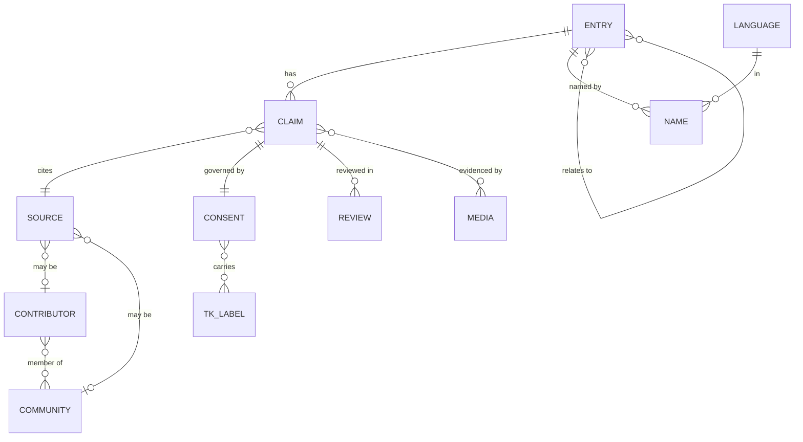

# Data model

*Status: proposed v0. The machine-readable form will live in `packages/schemas/` (JSON Schema) and be the single source of truth for Rust, Dart, TypeScript and Python types.*

## Core idea: entries are made of claims

An **Entry** is a container (a plant, a recipe, a practice…). The **knowledge** lives in **Claims** — small, independently attributable, independently consented assertions. This is what makes it possible for one person to share a plant's name publicly, keep a remedy community-only, and refuse AI use of both.

## Entities

### Entry

`id`, `type` (`plant` | `recipe` | `practice` | `story` | `phrase` | `place`), `canonical_ref` (e.g. SANBI/GBIF taxon id for plants), `status`, timestamps.

Plant entries extend with: `taxon` (accepted name, authorship), `family`, `growth_form`, `distribution` (generalised), `conservation_status`, `harvest_sensitive` (bool), `toxicity_level`, `lookalikes[]`.

### Name

A name for an entry **in a language** — a primary record, not a translation.
`entry_id`, `language` (BCP-47 + our extension, e.g. `zu`, `xh`, `ve`, `ts`, `nr`, `ss`, `st`, `nso`, `tn`, `af`, `en`, `sasl`, `khi-…`), `script/orthography`, `text`, `dialect`, `audio_media_id`, `claim_id` (a name is itself a claim).

### Claim

The atomic unit.
`id`, `entry_id`, `kind` (`name` | `use` | `preparation` | `ritual` | `safety` | `ecology` | `story` | `note`), `body` (structured + free text, per language), `use_category` (e.g. `medicinal`, `food`, `craft`, `ceremonial`) where relevant, `source_id`, `confidence` (`documented` | `reported` | `inferred`), `review_status` (`unreviewed` | `community_reviewed` | `expert_reviewed` | `disputed`), `safety_review` (`unreviewed` | `reviewed` | `flagged`), `ai_generated` (bool), `supersedes`, `created_at`.

### Source

`id`, `kind` (`publication` | `dataset` | `contributor` | `community` | `custodian`), `citation`, `url`, `licence`, `contributor_id?`, `community_id?`, `retrieved_at`.

### Consent

Attached to every claim (and every media item). Immutable versions; newest governs.

- `visibility`: `public` | `community` | `custodian` | `sacred`
- `attribution`: `named` | `community_only` | `anonymous`
- `ai_use`: `none` | `retrieval_only` | `training_allowed` — **default `none`**
- `redistribution`: `none` | `non_commercial` | `open` (+ licence id)
- `expires_at?`, `revoked_at?`
- `granted_by` (contributor or community delegate), `agreement_version`
- `tk_labels[]` (Local Contexts)

### Contributor / Community / Language / Media / Review

- **Contributor:** pseudonymous by default; `display_name`, `languages[]`, `trust_tier`, `communities[]`; minimal personal data.
- **Community:** self-identified group; `custodians[]`; protocols; TK labels it issues.
- **Language:** code, endonym, custodians, reviewed status.
- **Media:** photo/audio/video with `consent`, `exif_scrubbed`, `precise_location` (private) vs `public_location` (blurred).
- **Review:** reviewer, decision, notes, timestamp — append-only.

## Trust tiers (contributors)

`new` → `trusted` → `reviewer` → `custodian`. Tiers affect review queue behaviour, never override consent.

## Example (illustrative)

See [`data/seed/example-entry.yaml`](https://github.com/konethegreat/reservoir/blob/main/data/seed/example-entry.yaml).

## Principles

- **Append-only history.** Claims are superseded, not overwritten; deletion is a consented withdrawal that tombstones content.
- **No orphan claims.** Source is mandatory. "Contributor" is a valid source.
- **Derived data inherits the strictest consent** of its inputs.
- **Locations are two values:** precise (restricted) and generalised (public).
- **Language-neutral core, language-specific bodies.** Claim bodies may exist in several languages; none is the "master".

## Open questions

1. Granularity: when does a claim split into two?
2. How to represent knowledge held by multiple communities with different protocols?
3. Representation of *disagreement* between communities/sources without hierarchy.
4. Versioning of consent when community protocols change.
