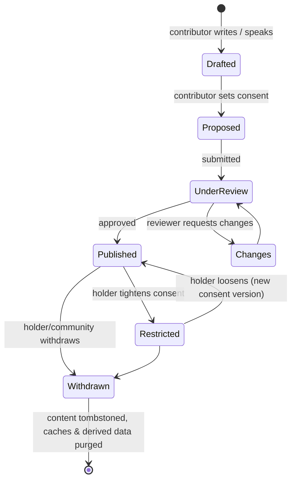

# Knowledge sovereignty

*Status: proposed. Requires legal review and community co-design before implementation. This is the most important document in the repository.*

## Premise

Reservoir does not own the knowledge it stewards. It holds it in trust, on terms set by those it belongs to. The software must make it **easy to do the right thing and hard to do the wrong thing**, including for the maintainers.

## The four controls on every claim

| Control | Values | Default |
|---|---|---|
| **Visibility** | `public` · `community` · `custodian` · `sacred` | `community` for community-sourced; `public` only for documented/published or explicitly consented |
| **Attribution** | `named` · `community_only` · `anonymous` | `named` (to the contributor's chosen display name) |
| **AI use** | `none` · `retrieval_only` · `training_allowed` | **`none`** |
| **Redistribution** | `none` · `non_commercial` · `open` | `none` |

Definitions:

- **public** — anyone, including search engines and the public API.
- **community** — verified members of the named community.
- **custodian** — only designated custodians (e.g. for ritual or initiation-related knowledge).
- **sacred** — stored encrypted; visible only to the holders; **never** passed to any AI service, indexed, cached off-device, or included in exports.
- **`retrieval_only`** — may be retrieved to answer a question *for a viewer already permitted to see it*; never used to train or fine-tune.
- **`training_allowed`** — may be included in datasets/models; requires explicit opt-in and community approval; logged.

## Enforcement points

1. **Core API policy engine** — every read, search, export and agent call is evaluated against (principal, claim, consent). No bypass for admins; admin access to restricted tiers is itself logged and requires a second approver.
2. **Query layer** — row-level security in PostgreSQL as defence in depth.
3. **Agent layer** — agents act *as a principal*; the model gateway filters context by `ai_use` before any model sees it. Sacred and `ai_use = none` content is never placed in a prompt.
4. **Sync** — devices receive only what the logged-in principal may see; restricted content is encrypted at rest on device.
5. **Search/index** — separate indexes per visibility tier; `public` index is the only one external crawlers can reach.
6. **Exports/datasets** — built only from `training_allowed` or `open` records, by an auditable job, with community sign-off.

## Consent lifecycle

- **Tightening is immediate**; loosening requires a fresh, explicit action and (for community knowledge) custodian confirmation.
- **Withdrawal** purges content from the live system, caches and derived indexes; backups age out on a published schedule. Models already trained on `training_allowed` data cannot be un-trained — which is why that tier is opt-in, rare and communicated honestly.

## Communities and custodians

- A **community** record is created by self-identification and strengthened by custodian verification.
- **Custodians** hold authority over community knowledge and language presentation; they can restrict, correct and withdraw items attributed to their community.
- **Disputes** between communities over the same knowledge are *not* resolved by the platform's engineers: both attributions can coexist; a Community Knowledge Council (future) mediates.

## Local Contexts alignment

Records can carry [TK / Biocultural Labels](https://localcontexts.org/) issued by communities (e.g. "TK Attribution", "TK Community Use Only", "TK Non-Commercial", "TK Secret/Sacred"). Reservoir's `visibility`/`redistribution` fields are enforced; labels are carried as additional machine-readable metadata and surfaced to users. We plan to integrate with the Local Contexts Hub **(verify API and terms)**.

## Alignment with the CARE principles

| CARE | In Reservoir |
|---|---|
| **C**ollective benefit | Free access, benefit-sharing policy, community-led datasets |
| **A**uthority to control | Per-claim consent, custodian veto, withdrawal |
| **R**esponsibility | Audit logs, transparency about AI use, capacity-building |
| **E**thics | FPIC, harm review, no extraction, cultural-sensitivity takedown |

## Things we will not build

- Bulk export of non-public tiers, for anyone
- "Admin override" that silently reveals restricted content
- Default-on data sharing or training
- Dark patterns that nudge contributors toward looser consent

## Testing this

Sovereignty rules are **tested like security properties**: unit tests per policy rule, property-based tests that no code path leaks a restricted claim, and red-team exercises on the agents (prompt injection attempting to extract restricted claims).
