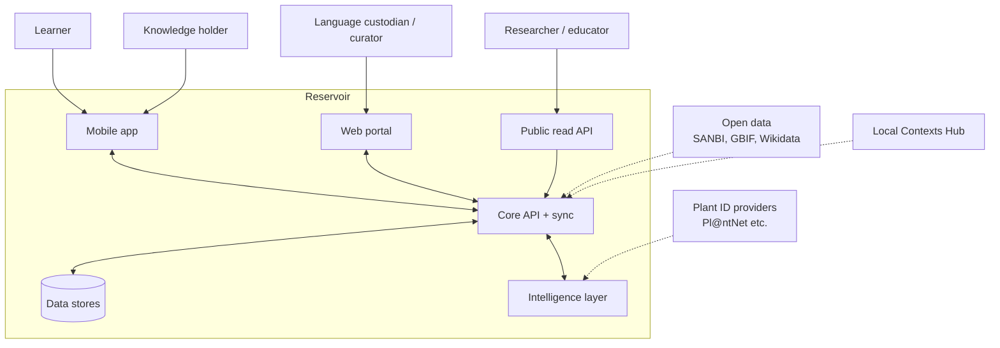
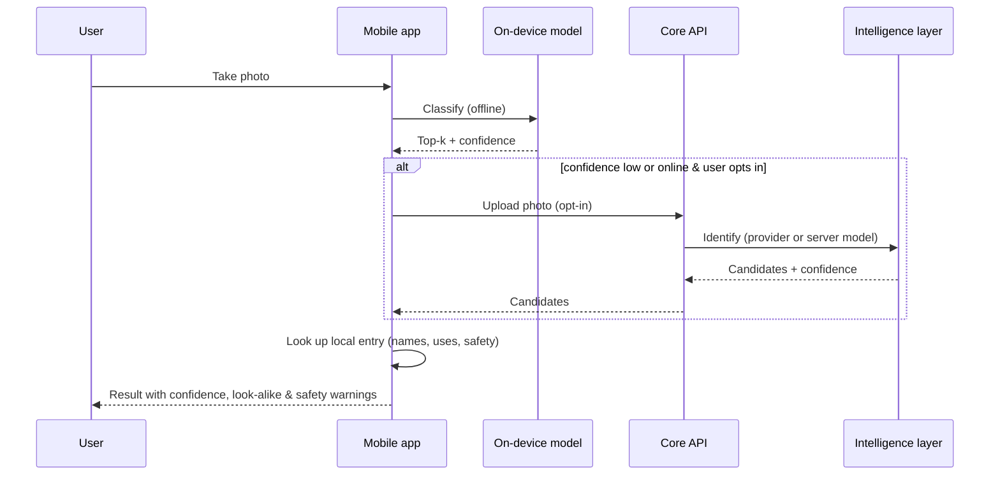
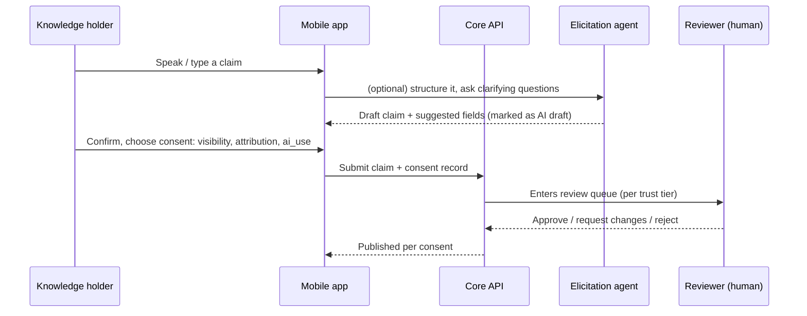

# System overview

*Status: proposed. Decisions are recorded as [ADRs](../adr/README.md).*

## Design drivers

1. **Sovereignty is structural** — consent, visibility and `ai_use` are enforced in the data layer, not the UI.
2. **Offline-first** — the phone is the primary computer.
3. **Provenance everywhere** — no claim without a source.
4. **Cheap to run** — a permanently free app must have a small bill.
5. **Safe AI** — retrieval-grounded, evaluated, human-supervised.
6. **Polyglot, contract-first** — each language where it is strongest, bound by shared schemas.

## Context

## Containers

| Container | Tech (proposed) | Responsibility |
|---|---|---|
| **Mobile app** (`apps/mobile`) | Flutter, SQLite (Drift), LiteRT | Camera, offline knowledge base, recording, contribution, sync |
| **Web portal** (`apps/web`) | TypeScript, Next.js | Public discovery pages (SEO), curator & custodian tools, admin |
| **Core API** (`apps/api`) | Rust, axum, sqlx | AuthN/Z, consent enforcement, CRUD, sync, media, search, audit log |
| **Agents** (`services/agents`) | Python | Agent fleet, retrieval, evaluation, speech/vision pipelines |
| **Model gateway** | Python (within agents) | Provider-agnostic routing, per-record `ai_use` enforcement, logging |
| **Database** | PostgreSQL + PostGIS + pgvector | System of record |
| **Object store** | S3-compatible | Images, audio, derived artefacts |
| **Schemas** (`packages/schemas`) | JSON Schema, OpenAPI | Contracts; generated clients |

## Key flows

### 1. Identify a plant

### 2. Contribute knowledge

### 3. Ask the AI

The agent retrieves only claims the *asker is allowed to see* **and** whose `ai_use` permits retrieval, composes an answer **with citations to claims**, and refuses when there is no supporting claim. See [AI agents](ai-agents.md).

## Cross-cutting concerns

- **Authorization:** policy engine evaluates (viewer, claim visibility, community membership, custodian role). Implemented in the Core API; the agent layer never reads the database directly — it calls the API on behalf of a principal.
- **Audit:** append-only log of reads of restricted tiers, edits, consent changes, AI invocations.
- **Privacy:** minimal personal data; location blurring; deletion and export per POPIA.
- **Observability:** OpenTelemetry traces across Rust/Python boundaries.
- **Internationalisation:** all user-facing strings externalised; per-language custodian review before release.
- **Accessibility:** voice-first options, high-contrast, large touch targets, low-literacy-friendly design.

## What is deliberately *not* here (yet)

- Microservices sprawl — start with a modular monolith (API) plus one agent service.
- Kubernetes — containers on a simple host first.
- Blockchain — no. Provenance is an append-only log.
- Social features — out of scope.
