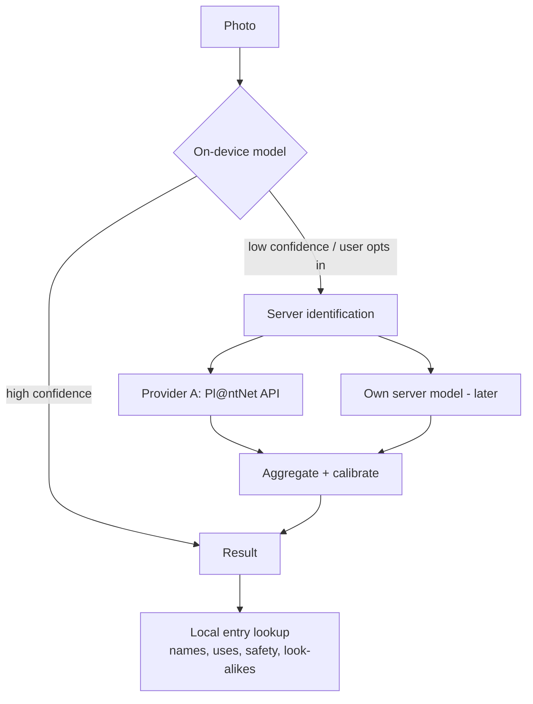

# Plant identification

*Status: proposed. Needs a benchmark spike on South African flora.*

## Goals

- Fast, useful identification for common South African plants from a phone photo.
- Works **offline** for the commonest species on low-end devices.
- Honest confidence; safe failure.
- Does not make the project dependent on a single third-party service.
- Respects the licences of the data that trains and validates it.

## Layered approach

1. **On-device, small model (Phase 1b–2).** A compact classifier (e.g. MobileNet/EfficientNet-class, quantised) on LiteRT/TFLite or ONNX Runtime Mobile, trained on a curated subset of South African flora (start with the few hundred most culturally and medicinally relevant species). Target: small download, <1 s on a low-end phone.
2. **Server-assisted (Phase 1).** Start by calling an established identification API such as [Pl@ntNet](https://my.plantnet.org/doc) (free tier reported at 500 requests/day, attribution required — **verify terms** and request non-profit terms for scale). Wrapped behind our own interface so providers can be swapped or combined.
3. **Own server model (later).** A larger model trained on consented / appropriately licensed imagery, including community-contributed photos with `training_allowed`.

## Data for training and evaluation

- **Evaluation set first.** Before choosing anything, build a small, expert-labelled South African test set (biome-balanced) — the basis of every decision.
- **Sources:** GBIF/iNaturalist research-grade observations (respect per-image licences; CC BY-NC data stays in a non-commercial partition), SANBI collections (permission), and community contributions.
- **Contributor photos** are used for training only when consent says `training_allowed`.
- Track **licence per image** in the dataset manifest.

## Confidence and calibration

- Raw softmax scores are not trustworthy. Calibrate (temperature scaling / isotonic regression) per model and evaluate Expected Calibration Error.
- Use **abstention**: if top-1 < threshold or top-1 vs top-2 are close, present "possible matches" instead.
- Consider **open-set** handling: species not in the model should result in "unknown", not a wrong confident guess.
- Show **look-alike** warnings from curated pairs regardless of confidence when a toxic species is among the top-k.

## Capture guidance

Photo quality dominates accuracy. The UI prompts for: whole plant, leaf (both sides), flower, fruit, bark — multiple images improve results (Pl@ntNet accepts several images of the same plant).

## Privacy

- Photos are processed on-device by default; uploading is opt-in per use.
- EXIF location is stripped before upload unless the contributor chooses to contribute an observation.
- Uploaded images for ID are not retained unless the user chooses to contribute them.

## Risks

| Risk | Mitigation |
|---|---|
| Provider outage / term change | Abstraction layer; on-device fallback |
| Poor accuracy on SA flora (succulents, fynbos, geophytes) | SA-specific evaluation; targeted fine-tuning |
| Licence contamination of training data | Dataset manifest with licence per image; partitioning |
| False confidence → harm | Calibration, abstention, look-alike alerts, no "safe to eat" statements |
| Cost at scale | Cache, on-device first, non-profit agreements |

## Spike tasks

1. Assemble a 300-species SA evaluation set (priority: medicinal/food/commonly confused).
2. Evaluate Pl@ntNet and one or two open models; report top-1/top-5 and calibration by biome.
3. Prototype a quantised on-device model; report size/latency on two low-end Android devices.
